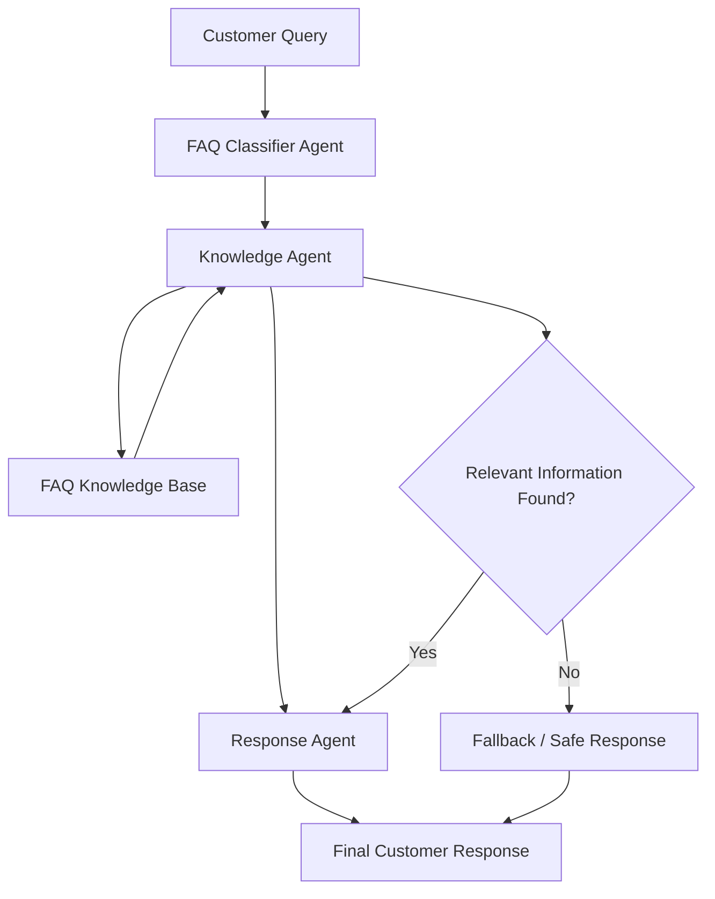

<div align="center">


<h2>Autonomous Multi-Agent FAQ Assistant</h2>

<p><em>Intelligent Customer Support · Collaborative Agents · Grounded Responses</em></p>

<p>
  
  
  
  
  
</p>

</div>

---

## ✦ Project Overview

**ShopSmart AI** is an autonomous multi-agent FAQ assistant designed to automate customer support operations for an online shopping platform.

It uses three specialized agents that collaborate to understand customer questions, retrieve relevant information from a structured knowledge base, and generate accurate, context-aware responses.

The system focuses on reliable information retrieval, clear communication, and preventing unsupported answers.

## ✦ Problem Statement

Traditional FAQ systems often rely on static keyword matching and provide limited flexibility when handling different customer queries.

ShopSmart AI addresses this challenge through a modular multi-agent architecture that separates query classification, knowledge retrieval, and response generation into independent responsibilities.

## ✦ Multi-Agent Architecture



## ✦ Agent Responsibilities

### 1. FAQ Classifier Agent

- Receives the customer's query.
- Identifies the query category and intent.
- Routes the query to the appropriate knowledge retrieval process.
- Supports different customer-service topics.

### 2. Knowledge Agent

- Searches the structured FAQ knowledge base.
- Retrieves relevant information based on the customer's question.
- Evaluates the relevance of retrieved content.
- Prevents unsupported information from being treated as verified knowledge.

### 3. Response Agent

- Processes the retrieved FAQ information.
- Produces a clear and customer-friendly response.
- Uses safe fallback responses when reliable information is unavailable.
- Maintains consistency across customer interactions.

## ✦ Knowledge Base

The project includes a structured FAQ dataset containing **29 FAQ entries** across the following categories:

| Category | Coverage |
|---|---|
| Orders | Order tracking and order-related questions |
| Payments | Payment methods and transactions |
| Deliveries | Shipping and delivery delays |
| Returns | Return policies and procedures |
| Refunds | Refund-related questions |
| General | General customer support queries |

Knowledge is maintained in:

`knowledge_base/faq_data.json`

## ✦ Anti-Hallucination Guardrail

ShopSmart AI includes a relevance-based guardrail to reduce unsupported responses.

- Uses a relevance threshold of `0.25`.
- Checks whether retrieved information is sufficiently relevant.
- Avoids presenting unrelated information as a verified answer.
- Uses a fallback response when the knowledge base cannot support the query.

This approach helps maintain grounded and reliable customer support responses.

## ✦ Technology Stack

| Component | Technology |
|---|---|
| Programming Language | Python |
| Backend | Python HTTP Server |
| Agent Architecture | Custom Multi-Agent Pipeline |
| Knowledge Storage | JSON |
| Frontend | HTML, CSS, JavaScript |
| Testing | Python unittest |
| API | REST API |

## ✦ Project Structure

```text
ShopSmart-AI/
│
├── agents/
│   ├── base_agent.py
│   ├── classifier_agent.py
│   ├── knowledge_agent.py
│   ├── response_agent.py
│   └── llm_client.py
│
├── knowledge_base/
│   └── faq_data.json
│
├── web/
│   └── index.html
│
├── tests/
│   ├── test_faq_assistant.py
│   └── test_frontend_dom.py
│
├── assistant.py
├── main.py
├── server.py
├── .env.example
├── .gitignore
└── README.md
```

## ✦ Installation & Setup

**1. Clone the repository**

```bash
git clone https://github.com/haniaeman2026-pixel/ShopSmart-AI.git
```

**2. Navigate to the project directory**

```bash
cd ShopSmart-AI
```

**3. Run the application**

```bash
py server.py 8010
```

**4. Open the application**

```text
http://localhost:8010/
```

## ✦ REST API Endpoints

| Method | Endpoint | Description |
|---|---|---|
| GET | `/api/health` | Checks server health |
| GET | `/api/kb` | Returns FAQ knowledge base |
| GET | `/api/history` | Retrieves interaction history |
| POST | `/api/ask` | Processes a customer query |
| POST | `/api/classify` | Classifies query intent |
| POST | `/api/retrieve` | Retrieves relevant FAQ information |
| POST | `/api/respond` | Generates a grounded response |

## ✦ Testing & Validation

The project includes automated tests covering the agent pipeline, FAQ retrieval, response handling, and frontend behavior.

**Test execution:**

```bash
py -m unittest discover -s tests -v
```

**Test Results:**

- Total Tests: 45
- Status: Passed
- Test Framework: Python unittest

## ✦ Demonstrated Use Cases

The assistant was validated against six customer-support scenarios:

| Scenario | Expected Behavior |
|---|---|
| Order Tracking | Provides order-related guidance |
| Payment Methods | Answers payment questions |
| Delivery Delay | Handles delivery-related queries |
| Returns | Provides return information |
| Refunds | Answers refund-related questions |
| Out-of-Scope Query | Safely handles unsupported questions |

The out-of-scope scenario also verifies that the assistant does not invent answers to unrelated questions, such as requests about a Mars spaceship.

## ✦ Implementation Note

The current implementation uses a **deterministic three-agent pipeline** with rule-based classification, FAQ retrieval, and template-based grounded responses.

The optional `llm_client.py` module checks provider connectivity, but live LLM-generated responses are not currently part of the active answer-generation pipeline.

## ✦ Future Enhancements

- Live LLM-powered response generation.
- Expanded FAQ knowledge base.
- Persistent conversation history.
- Advanced semantic retrieval.
- Improved analytics and customer-support insights.

---

<div align="center">

### ✧ Developed with Python & Multi-Agent Architecture ✧

**Developed by Hania Eman**

<sub>ShopSmart AI · Intelligent Customer Operations</sub>

</div>
