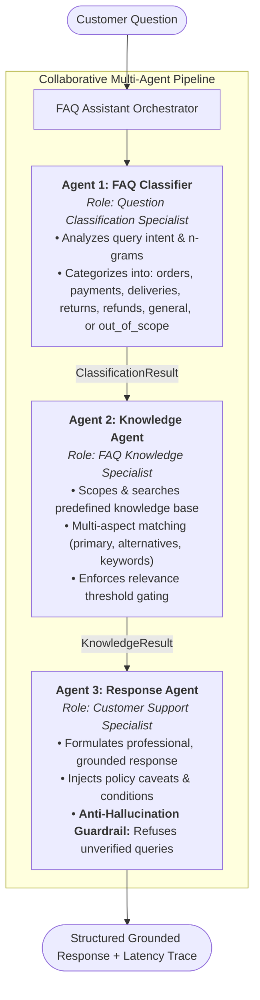
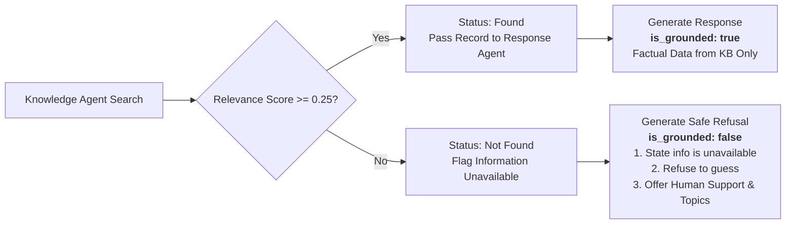

# 🛍️ ShopSmart AI — Autonomous Multi-Agent FAQ Assistant

[](#-automated-test-suite)
[](#-multi-agent-system-architecture)
[](#-installation--setup)
[-success)](#-technology-stack)
[](#-anti-hallucination-engine-requirement-5)

An enterprise-grade, multi-agent AI customer support assistant built for an online retail shopping platform. The system autonomously processes high-volume customer inquiries regarding **orders**, **payments**, **deliveries**, **returns**, **refunds**, and **general queries**, enforcing strict factual grounding against a predefined knowledge base to prevent hallucinations.

---

## 📋 Table of Contents
1. [Project Overview & Problem Statement](#-project-overview--problem-statement)
2. [Multi-Agent System Architecture](#-multi-agent-system-architecture)
3. [Agent Roles & Responsibilities](#-agent-roles--responsibilities)
4. [Knowledge Base Coverage](#-knowledge-base-coverage)
5. [Anti-Hallucination Engine (Requirement 5)](#-anti-hallucination-engine-requirement-5)
6. [Technology Stack](#-technology-stack)
7. [Project Directory Layout](#-project-directory-layout)
8. [Installation & Setup](#-installation--setup)
9. [Execution & Run Guide](#-execution--run-guide)
10. [REST API Documentation](#-rest-api-documentation)
11. [Automated Test Suite (45 Tests)](#-automated-test-suite-45-tests)
12. [Six Core Assignment Scenarios](#-six-core-assignment-scenarios)

---

## 📌 Project Overview & Problem Statement

An online retail store receives hundreds of questions daily concerning shipments, refunds, returns, order updates, and payment methods. The objective is to replace manual repetitive triage with an autonomous, high-precision **Multi-Agent FAQ Assistant** satisfying five core mandates:

1. **Accept a customer question** across diverse phrasings and lengths.
2. **Identify the category** of the inquiry with intent recognition and confidence scoring.
3. **Search a predefined FAQ knowledge base** using multi-aspect semantic and lexical matching.
4. **Generate an appropriate response** grounded exclusively in verified policy information.
5. **Avoid inventing answers** when verified information is unavailable (strictly eliminate hallucinations).

---

## 🏛️ Multi-Agent System Architecture

The application implements an orchestrated pipeline of three specialized autonomous agents:



---

## 👥 Agent Roles & Responsibilities

### 1. FAQ Classifier (`FAQClassifierAgent`)
- **Role:** *Question Classification Specialist*
- **Source:** [`agents/classifier_agent.py`
- **Responsibilities:**
  - Tokenizes, normalizes, and extracts n-grams from customer inquiries.
  - Computes weighted lexical scores across six business domains (`orders`, `payments`, `deliveries`, `returns`, `refunds`, `general`).
  - Contextual disambiguation heuristics (e.g. distinguishing refund status inquiries from physical return requests).
  - Emits structured `ClassificationResult` containing top category, confidence (0.0 to 1.0), detected keywords, and execution latency trace.

### 2. Knowledge Agent (`KnowledgeAgent`)
- **Role:** *FAQ Knowledge Specialist*
- **Source:** [`agents/knowledge_agent.py`
- **Responsibilities:**
  - Indexes and maintains the 29-entry predefined knowledge base in [`knowledge_base/faq_data.json`.
  - Multi-aspect relevance scoring:
    - Exact query string matching against canonical & alternative questions.
    - Token Jaccard similarity with suffix normalization.
    - Multi-word keyword phrase boosting.
    - Category-scoped search with cross-domain fallback.
  - Enforces minimum relevance threshold (`0.25`). If no FAQ meets the threshold, returns `status = "not_found"`.
  - Emits structured `KnowledgeResult` with top match, relevance score, related items, and execution trace.

### 3. Response Agent (`ResponseAgent`)
- **Role:** *Customer Support Specialist*
- **Source:** [`agents/response_agent.py`
- **Responsibilities:**
  - Synthesizes clear, empathetic, and professional customer service answers.
  - Strictly constrains all claims to the factual content of the retrieved FAQ.
  - Injects verified policy notices, conditions, and SLA timeframes.
  - Suggests related FAQ articles when applicable.
  - **Requirement 5 Enforcer:** If knowledge is unavailable or out-of-scope, gracefully refuses to invent details, specifies that verified FAQ information is absent, and provides human representative contact details.
  - Emits structured `ResponseResult` with `is_grounded`, `grounding_source_id`, and full audit trail.

---

## 📚 Knowledge Base Coverage

The predefined knowledge repository (`knowledge_base/faq_data.json`) contains 29 realistic e-commerce FAQ records across all six domains:

| Category | FAQ ID Range | Topics Covered |
|---|---|---|
| **Orders** | `ORD-001` - `ORD-006` | Order placement, 30-min cancellation/modification window, live shipment tracking, address changes, VAT invoice downloads, order confirmation delivery. |
| **Payments** | `PAY-001` - `PAY-005` | Accepted payment methods (Visa, MC, PayPal, Apple Pay), 256-bit SSL & PCI-DSS security, declined card troubleshooting, Cash on Delivery (COD) limits, Klarna/Afterpay BNPL installments. |
| **Deliveries** | `DEL-001` - `DEL-006` | Standard delivery timeline (3-5 days), express/same-day shipping, free shipping over $50, international shipping to 50+ countries, missed delivery attempts, **delivery delay resolution**. |
| **Returns** | `RET-001` - `RET-005` | 30-day return policy, non-returnable hygiene items, step-by-step return label generation, return shipping fee rules ($5.99 change-of-mind vs. $0 defective), packaging/wear condition guidelines. |
| **Refunds** | `REF-001` - `REF-005` | Refund processing times (2-3 day warehouse inspection + 3-7 day bank payout), original payment method constraint, 10% bonus store credit option, promo voucher deductions, missing refund investigations. |
| **General** | `GEN-001` - `GEN-003` | Customer care operating hours (Mon-Fri 09:00-18:00 EST), phone/email support channels, account creation, password reset procedures. |

---

## 🛡️ Anti-Hallucination Engine (Requirement 5)

A core requirement is to **avoid inventing answers when information is unavailable**. The system implements a deterministic two-phase guardrail:



**Refusal Guarantee:** Under no circumstance will the assistant hallucinate delivery windows to impossible locations (e.g., Antarctica, Mars), fabricate return policies for non-existent items, or guess refund terms.

---

## 💻 Technology Stack

- **Runtime:** Python 3.12+ (Standard Library: `http.server`, `urllib`, `json`, `dataclasses`, `unittest`, `re`).
- **Dependencies:** **Zero external package dependencies required.** Runs instantly on any clean environment.
- **Frontend:** Responsive enterprise dashboard built with semantic HTML5, modern CSS3 (slate design system), and vanilla JavaScript.
- **Testing:** Python `unittest` suite with 45 unit, integration, and DOM tests.
- **LLM Augmentation:** Built-in `agents/llm_client.py` reports optional provider connectivity only; it does not generate customer answers. The current response pipeline is deterministic and grounded in the local FAQ knowledge base.

---

## 📂 Project Directory Layout

```text
antigravity/
├── knowledge_base/
│   └── faq_data.json          # Predefined 29-entry FAQ Knowledge Base
├── agents/
│   ├── __init__.py            # Module exports
│   ├── base_agent.py          # Abstract BaseAgent & AgentTrace dataclasses
│   ├── classifier_agent.py    # Agent 1: FAQ Classifier (Question Classification Specialist)
│   ├── knowledge_agent.py     # Agent 2: Knowledge Agent (FAQ Knowledge Specialist)
│   ├── response_agent.py      # Agent 3: Response Agent (Customer Support Specialist)
│   └── llm_client.py          # Optional provider connectivity probe (not answer generation)
├── assistant.py               # Main multi-agent orchestrator & pipeline coordinator
├── main.py                    # Multi-mode CLI tool (demo, interactive, single question, JSON)
├── server.py                  # HTTP API server & web dashboard host
├── web/
│   └── index.html             # Enterprise visual multi-agent live dashboard
├── tests/
│   ├── __init__.py            # Test package
│   ├── test_faq_assistant.py  # 42 unit & integration tests
│   └── test_frontend_dom.py   # 3 DOM structure & JS syntax tests
├── .env.example               # Environment variables configuration template
├── .gitignore                 # Standard clean ignore file
└── README.md                  # Comprehensive documentation
```

---

## ⚡ Installation & Setup

1. **Clone or Navigate to the Workspace:**
   ```bash
   cd "c:\Users\fattani computer\OneDrive\Desktop\antigravity"
   ```

2. **Verify Python 3.10 or newer is Available:**
   ```bash
   py --version
   ```

3. **(Optional) Configure Environment Variables:**
   Copy `.env.example` to `.env` if you wish to configure an optional LLM provider:
   ```bash
   cp .env.example .env
   ```
   *(Note: The current implementation runs locally without API keys. It uses deterministic classification, FAQ retrieval, and grounded response templates; no external LLM inference is performed.)*

---

## 🚀 Execution & Run Guide

### 1. Run Predefined Demo Suite
Executes the six primary assignment scenarios plus additional edge cases:
```bash
py main.py
```

### 2. Single Question via CLI
```bash
py main.py --question "How long does standard delivery take?"
```

### 3. Machine-Readable JSON Output
```bash
py main.py --question "When will I receive my refund?" --json
```

### 4. Interactive Terminal Session
```bash
py main.py --interactive
```

### 5. Launch the Web Dashboard
```bash
py server.py 8000
```
Open your browser at `http://localhost:8000`.

---

## 🌐 REST API Documentation

The server exposes dedicated REST endpoints for the complete pipeline as well as individual agent inspection:

| Method | Endpoint | Description | Request Body | Response |
|---|---|---|---|---|
| `GET` | `/api/health` | Service health, active agents, and LLM provider status | None | `{"status": "healthy", "agents": {...}, "llm_provider": {...}}` |
| `GET` | `/api/kb` | Returns full knowledge base entries and metadata | None | `{"metadata": {...}, "total_faqs": 29, "faqs": [...]}` |
| `GET` | `/api/history` | Chronological session inquiry history | None | `{"history": [...]}` |
| `POST` | `/api/ask` | End-to-end multi-agent pipeline execution | `{"question": "..."}` | `{"category": "...", "response_text": "...", "is_grounded": true, "agent_traces": [...]}` |
| `POST` | `/api/classify` | Invokes Agent 1 (FAQ Classifier) in isolation | `{"question": "..."}` | `{"category": "...", "confidence": 0.98, "detected_keywords": [...]}` |
| `POST` | `/api/retrieve` | Invokes Agent 2 (Knowledge Agent) in isolation | `{"query": "...", "category": "..."}` | `{"status": "found", "best_match": {...}, "top_score": 1.0}` |
| `POST` | `/api/respond` | Invokes Agent 3 (Response Agent) in isolation | `{"question": "...", "category": "..."}` | `{"response_text": "...", "is_grounded": true, ...}` |

---

## 🧪 Automated Test Suite (45 Tests)

Run all 45 unit, integration, scenario, and DOM tests:
```bash
py -m unittest discover -s tests -v
```

### Test Coverage Summary:
- **`TestAssignmentSixScenarios` (6 tests):** Validates Scenarios 1 through 6.
- **`TestFAQClassifierAgent` (14 tests):** Validates classification across orders, payments, deliveries, delays, returns, refunds, general queries, empty strings, and out-of-scope inputs.
- **`TestKnowledgeAgent` (6 tests):** Validates knowledge base indexing, exact matching, semantic retrieval, empty queries, and threshold gating.
- **`TestResponseAgent` (2 tests):** Validates grounded answer synthesis and anti-hallucination refusal formatting.
- **`TestEndToEndPipeline` (4 tests):** Validates trace propagation, sub-100ms latency, serialization, and LLM status structure.
- **`TestHTTPAPIEndpoints` (9 tests):** Validates all REST API routes, 400 bad request handling, and 404 routing.
- **`TestFrontendIntegrity` (3 tests):** Validates HTML structure, presence of 25 required DOM IDs, and Node.js JavaScript syntax verification.

---

## 🎯 Six Core Assignment Scenarios

The six scenarios from Section 9 are verified and guaranteed by automated tests:

### Scenario 1: Order Tracking
- **Input:** *"How can I track my order?"*
- **Agent 1:** Classified into `orders` (confidence: `0.98`, keywords: `['order']`).
- **Agent 2:** Retrieved FAQ `ORD-003` (*"How do I track my order status?"*).
- **Agent 3:** Formulates grounded response with shipping confirmation details, carrier link instructions, and 24-hour update condition.
- **Status:** **PASS**

### Scenario 2: Payment Methods
- **Input:** *"Which payment methods do you accept?"*
- **Agent 1:** Classified into `payments` (confidence: `0.98`, keywords: `['payment']`).
- **Agent 2:** Retrieved FAQ `PAY-001` (*"What payment methods do you accept?"*).
- **Agent 3:** Lists Visa, MasterCard, Amex, PayPal, Apple Pay, Google Pay, and gift cards.
- **Status:** **PASS**

### Scenario 3: Delivery Delay
- **Input:** *"My delivery is delayed. What should I do?"*
- **Agent 1:** Classified into `deliveries` (confidence: `0.98`, keywords: `['delivery', 'delayed']`).
- **Agent 2:** Retrieved FAQ `DEL-006` (*"My delivery is delayed. What should I do?"*).
- **Agent 3:** Explains checking tracking status, customs/weather exceptions, and support escalation for delays > 2 days past ETA.
- **Status:** **PASS**

### Scenario 4: Return Procedures
- **Input:** *"How can I return a product?"*
- **Agent 1:** Classified into `returns` (confidence: `0.55`, keywords: `['return']`).
- **Agent 2:** Retrieved FAQ `RET-001` / `RET-003` (*"How do I initiate a return request?"*).
- **Agent 3:** Formulates step-by-step instructions (My Orders > Return Item > Print prepaid label > Drop-off).
- **Status:** **PASS**

### Scenario 5: Refund Timeline
- **Input:** *"When will I receive my refund?"*
- **Agent 1:** Classified into `refunds` (confidence: `0.98`, keywords: `['refund']`).
- **Agent 2:** Retrieved FAQ `REF-001` (*"How long does a refund take to process?"*).
- **Agent 3:** Outlines the 2-3 business days inspection + 3-7 business days banking credit timeline.
- **Status:** **PASS**

### Scenario 6: Missing Policy (Anti-Hallucination Guardrail)
- **Input:** *"Can you deliver my order via spaceship to Mars?"*
- **Agent 1:** Classified into `deliveries`.
- **Agent 2:** Top relevance score `0.111` is below threshold (`0.25`). Returns `status = "not_found"`.
- **Agent 3:** **Refuses to guess.** Transparently notes the policy is unavailable in the FAQ knowledge base, provides support email/phone, and lists supported inquiry domains.
- **Status:** **PASS**


## Important Implementation Note

This submission currently uses a deterministic three-agent pipeline (rule-based intent classification, FAQ retrieval, and template-based grounded response generation). The optional `llm_client.py` performs a provider connectivity check only; it is **not** connected to answer generation. Do not describe the current build as using a live generative LLM unless that integration is implemented and tested separately.

The web server serves `web/index.html` at `/`. If Chrome shows a JSON 404 page, stop any older server process using port 8000 (`Ctrl+C` in its terminal), then start this project's server from the project root with `py server.py 8000`. Confirm the terminal prints the ShopSmart URL before opening `http://localhost:8000/`.
