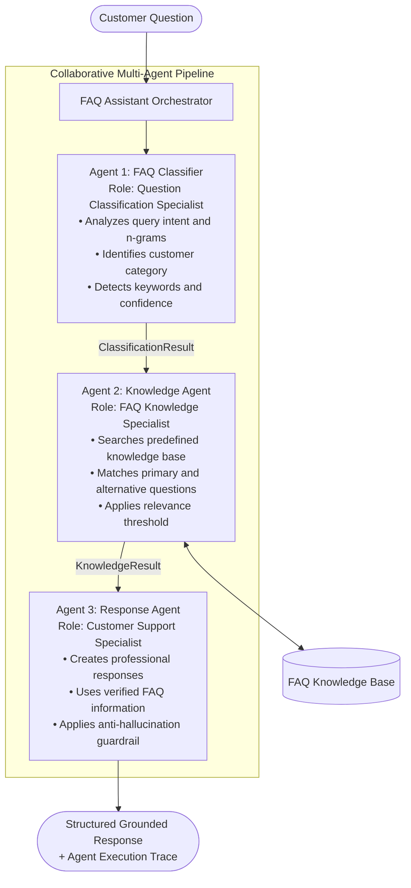
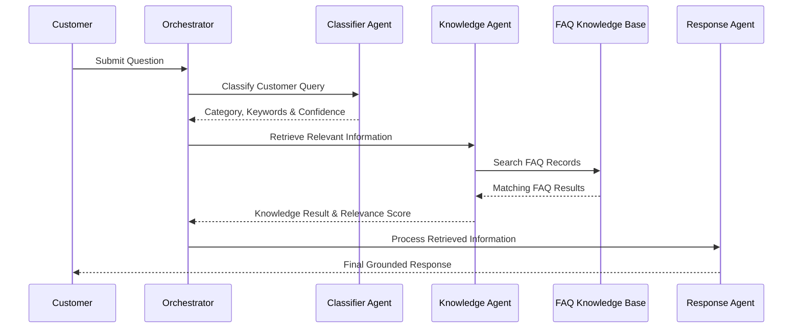
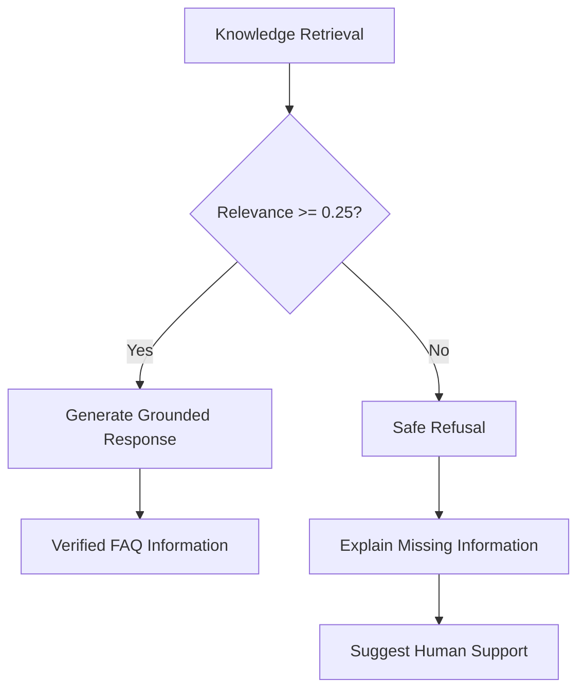

 <div align="center">


<h2>Autonomous Multi-Agent FAQ Assistant</h2>

<p><em>Intelligent Customer Support · Collaborative Agents · Grounded Responses</em></p>

</div>

<p align="center">
  
  
  
  
  
</p>

---

## 📌 Project Overview

ShopSmart AI is a multi-agent FAQ assistant designed for online retail customer support. It handles customer questions about orders, payments, deliveries, returns, refunds, and general inquiries.

Its main goal is to automate customer support through specialized agents while ensuring responses remain grounded in verified FAQ information.

## 📋 Table of Contents

1. Project Overview
2. Multi-Agent Architecture
3. Agent Roles & Responsibilities
4. Knowledge Base
5. Anti-Hallucination Engine
6. Technology Stack
7. Project Structure
8. Installation & Execution
9. REST API Documentation
10. Automated Tests
11. Core Assignment Scenarios

---

## 🏛️ Multi-Agent System Architecture

ShopSmart AI uses three specialized agents coordinated by a central orchestrator. Each agent performs a separate task and passes its structured result to the next agent.



### Agent Call Flow



## 👥 Agent Roles & Responsibilities

### 1. FAQ Classifier Agent

- Identifies customer intent and query category.
- Extracts keywords and calculates confidence.
- Supports six business categories and out-of-scope queries.

**Source:** `agents/classifier_agent.py`

### 2. Knowledge Agent

- Searches the 29-entry FAQ knowledge base.
- Uses exact matching, keyword matching, and similarity scoring.
- Applies a minimum relevance threshold of `0.25`.

**Source:** `agents/knowledge_agent.py`

### 3. Response Agent

- Generates clear and professional customer responses.
- Uses verified FAQ information only.
- Refuses unsupported queries instead of inventing answers.

**Source:** `agents/response_agent.py`

---

## 📚 Knowledge Base Coverage

The knowledge base contains 29 FAQ records across six categories.

| Category | FAQs | Coverage |
|---|---:|---|
| Orders | 6 | Tracking, cancellation, invoices |
| Payments | 5 | Payment methods, security, declined cards |
| Deliveries | 6 | Shipping, delays, delivery tracking |
| Returns | 5 | Return policies and procedures |
| Refunds | 5 | Processing times and refund issues |
| General | 3 | Accounts and customer support |

**Knowledge file:** `knowledge_base/faq_data.json`

## 🛡️ Anti-Hallucination Engine

The system checks retrieved information before generating a response.



The assistant does not guess when information is unavailable. It uses a safe fallback response for unsupported questions.

## 💻 Technology Stack

| Component | Technology |
|---|---|
| Language | Python 3.12+ |
| Backend | Python HTTP Server |
| Architecture | Custom Multi-Agent Pipeline |
| Knowledge Base | JSON |
| Frontend | HTML, CSS, JavaScript |
| Testing | Python unittest |
| Dependencies | Python Standard Library |

**Implementation note:** The current system uses deterministic classification, FAQ retrieval, and template-based responses. `llm_client.py` checks optional provider connectivity but does not generate customer answers using a live LLM.

## 📂 Project Structure

```text
antigravity/
├── knowledge_base/
│   └── faq_data.json
├── agents/
│   ├── base_agent.py
│   ├── classifier_agent.py
│   ├── knowledge_agent.py
│   ├── response_agent.py
│   └── llm_client.py
├── web/
│   └── index.html
├── tests/
│   ├── test_faq_assistant.py
│   └── test_frontend_dom.py
├── assistant.py
├── main.py
├── server.py
├── .env.example
├── .gitignore
└── README.md
```

## ⚡ Installation & Execution

**1. Open the project directory**

```powershell
cd "C:\Users\fattani computer\Downloads\antigravity-fixed (3)\antigravity"
```

**2. Verify Python**

```powershell
py --version
```

**3. Run the application**

```powershell
py server.py 8010
```

**4. Open the dashboard**

```text
http://localhost:8010/
```

### Other Execution Modes

```powershell
py main.py
py main.py --interactive
py main.py --question "How can I track my order?"
py main.py --question "When will I receive my refund?" --json
```

## 🌐 REST API Documentation

| Method | Endpoint | Purpose |
|---|---|---|
| GET | `/api/health` | Server health and agent status |
| GET | `/api/kb` | FAQ knowledge base |
| GET | `/api/history` | Inquiry history |
| POST | `/api/ask` | Complete multi-agent pipeline |
| POST | `/api/classify` | Query classification |
| POST | `/api/retrieve` | FAQ retrieval |
| POST | `/api/respond` | Response generation |

## 🧪 Automated Test Suite

Run all tests:

```powershell
py -m unittest discover -s tests -v
```

**Test Results: 45 Tests Passed**

| Test Suite | Tests |
|---|---:|
| Assignment Scenarios | 6 |
| FAQ Classifier | 14 |
| Knowledge Agent | 6 |
| Response Agent | 2 |
| End-to-End Pipeline | 4 |
| HTTP API | 9 |
| Frontend Integrity | 3 |
| **Total** | **45** |

## 🎯 Six Core Assignment Scenarios

| Scenario | Expected Result |
|---|---|
| Order Tracking | Retrieves tracking FAQ |
| Payment Methods | Lists accepted payment options |
| Delivery Delay | Provides delay guidance |
| Return Procedures | Explains return process |
| Refund Timeline | Provides refund information |
| Unsupported Query | Refuses to invent an answer |

All six scenarios passed the automated assignment tests.

---

## ✧ Important Implementation Note

ShopSmart AI currently operates through a deterministic three-agent pipeline. It does not use live LLM inference for customer responses.

The web server serves the dashboard from `web/index.html`. If port `8000` is occupied, stop the older server and run:

```powershell
py server.py 8010
```

Open `http://localhost:8010/` in your browser.

---

<div align="center">

**Developed by Hania Eman**

*ShopSmart AI · Intelligent Customer Operations*

</div>
