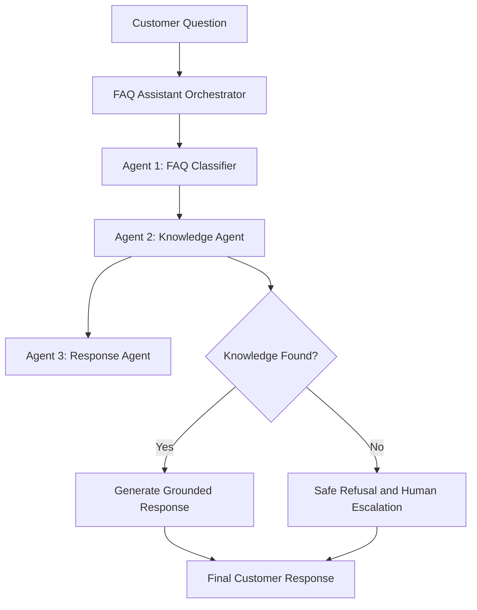

# 🛍️ ShopSmart AI

<p align="center">
  
</p>

<p align="center">
  
  
  
  
  
</p>

<p align="center">
  An enterprise-style multi-agent customer support assistant for online shopping platforms.
</p>

---

## 📌 Project Overview

ShopSmart AI is a multi-agent FAQ assistant designed to automate customer support inquiries for an online retail platform.

It processes customer questions related to:

- Orders and order tracking
- Payment methods
- Deliveries and shipping delays
- Returns and return policies
- Refunds and refund timelines
- General customer support

The system uses three specialized agents to classify questions, retrieve relevant FAQ information, and generate accurate responses grounded in a predefined knowledge base.

A strict anti-hallucination mechanism prevents the assistant from inventing answers when verified information is unavailable.

## 🏛️ Multi-Agent System Architecture

The application follows a collaborative three-agent workflow.



## 👥 Agent Roles & Responsibilities

### 1. FAQ Classifier Agent

**File:** `agents/classifier_agent.py`

Responsibilities:

- Analyzes customer questions.
- Normalizes and tokenizes user input.
- Identifies the most relevant inquiry category.
- Calculates classification confidence.
- Extracts relevant keywords.
- Produces a structured classification result.

Supported categories:

`orders`, `payments`, `deliveries`, `returns`, `refunds`, `general`, and `out_of_scope`.

### 2. Knowledge Agent

**File:** `agents/knowledge_agent.py`

Responsibilities:

- Searches the predefined FAQ knowledge base.
- Matches customer questions with relevant FAQ records.
- Uses exact matching, keyword matching, and similarity scoring.
- Applies category-based retrieval.
- Enforces a minimum relevance threshold of `0.25`.
- Returns `not_found` when no sufficiently relevant FAQ is available.

### 3. Response Agent

**File:** `agents/response_agent.py`

Responsibilities:

- Generates clear and professional customer support responses.
- Uses retrieved FAQ information as its factual source.
- Includes relevant policy conditions.
- Suggests related FAQ information when applicable.
- Refuses to guess when verified information is unavailable.
- Provides human-support escalation details when appropriate.

## 📚 Knowledge Base Coverage

The predefined knowledge base contains 29 FAQ records.

| Category | FAQ IDs | Coverage |
|---|---|---|
| Orders | ORD-001 to ORD-006 | Tracking, cancellation, modifications, invoices |
| Payments | PAY-001 to PAY-005 | Payment methods, security, declined payments |
| Deliveries | DEL-001 to DEL-006 | Shipping, delivery delays, international delivery |
| Returns | RET-001 to RET-005 | Return policies, labels, shipping fees |
| Refunds | REF-001 to REF-005 | Refund processing, timelines, investigations |
| General | GEN-001 to GEN-003 | Account support, contact information, password reset |

## 🛡️ Anti-Hallucination Guardrail

One of the main requirements is to prevent the assistant from generating unsupported answers.

ShopSmart AI implements a relevance-based verification mechanism.

**When relevant information is found:**
- The retrieved FAQ is passed to the Response Agent.
- The response is generated using verified knowledge base information.
- The result is marked as grounded.

**When relevant information is unavailable:**
- The system returns `not_found`.
- The Response Agent refuses to invent an answer.
- The customer is informed that verified information is unavailable.
- Human support escalation is suggested.

Example:

**Customer Question:**
"Can you deliver my order via spaceship to Mars?"

**System Result:**
The knowledge base cannot verify this delivery policy, so the assistant refuses to guess.

## 💻 Technology Stack

| Component | Technology |
|---|---|
| Programming Language | Python |
| Backend | Python HTTP Server |
| Frontend | HTML5, CSS3, JavaScript |
| Agent Architecture | Collaborative Multi-Agent System |
| Knowledge Storage | JSON |
| API | REST API |
| Testing | Python unittest |
| Dependencies | Python Standard Library |

**Implementation Note:** The current version uses deterministic intent classification, FAQ retrieval, and template-based grounded response generation. The optional `llm_client.py` checks provider connectivity only; it does not generate customer answers through a live LLM.

## 📂 Project Structure

```text
ShopSmart-AI/
│
├── agents/
│   ├── __init__.py
│   ├── base_agent.py
│   ├── classifier_agent.py
│   ├── knowledge_agent.py
│   ├── response_agent.py
│   └── llm_client.py
│
├── knowledge_base/
│   └── faq_data.json
│
├── tests/
│   ├── __init__.py
│   ├── test_faq_assistant.py
│   └── test_frontend_dom.py
│
├── web/
│   └── index.html
│
├── assistant.py
├── main.py
├── server.py
├── .env.example
├── .gitignore
└── README.md
```

## ⚡ Installation & Setup

### 1. Clone the Repository

```bash
git clone https://github.com/haniaeman2026-pixel/ShopSmart-AI.git
```

### 2. Navigate to the Project

```bash
cd ShopSmart-AI
```

### 3. Verify Python

```bash
py --version
```

Python 3.10 or newer is recommended.

### 4. Run the Application

No external Python packages are required for the current implementation.

## 🚀 Execution & Run Guide

### Launch the Web Dashboard

```bash
py server.py 8010
```

Open the application:

```text
http://localhost:8010/
```

### Run the Predefined Demo

```bash
py main.py
```

### Ask a Single Question

```bash
py main.py --question "How long does standard delivery take?"
```

### Get JSON Output

```bash
py main.py --question "When will I receive my refund?" --json
```

### Interactive Terminal Mode

```bash
py main.py --interactive
```

## 🌐 REST API Documentation

| Method | Endpoint | Description |
|---|---|---|
| GET | `/api/health` | Service health and agent status |
| GET | `/api/kb` | Knowledge base records |
| GET | `/api/history` | Inquiry session history |
| POST | `/api/ask` | Complete multi-agent workflow |
| POST | `/api/classify` | FAQ classification |
| POST | `/api/retrieve` | Knowledge retrieval |
| POST | `/api/respond` | Response generation |

Example request:

```json
{
  "question": "How can I track my order?"
}
```

## 🧪 Automated Test Suite

The project includes **45 automated tests** covering the multi-agent workflow, knowledge retrieval, API functionality, and frontend integrity.

Run the complete test suite:

```bash
py -m unittest discover -s tests -v
```

Test coverage includes:

- Six core assignment scenarios
- FAQ classification
- Knowledge base retrieval
- Response generation
- Anti-hallucination guardrails
- End-to-end pipeline execution
- REST API endpoints
- Frontend structure and JavaScript syntax

**Verified Result:** All 45 tests passed.

## 🎯 Six Core Assignment Scenarios

| Scenario | Customer Inquiry | Expected Result |
|---|---|---|
| 1. Order Tracking | How can I track my order? | ORD-003 retrieved |
| 2. Payment Methods | Which payment methods do you accept? | PAY-001 retrieved |
| 3. Delivery Delay | My delivery is delayed. What should I do? | DEL-006 retrieved |
| 4. Return Procedures | How can I return a product? | Return FAQ retrieved |
| 5. Refund Timeline | When will I receive my refund? | REF-001 retrieved |
| 6. Missing Policy | Can you deliver via spaceship to Mars? | Safe refusal |

All six assignment scenarios have been successfully tested.

## 🔒 Security & Reliability

- No API keys are required for the current deterministic workflow.
- Environment files are excluded from version control.
- Customer responses are grounded in the local FAQ knowledge base.
- Unsupported questions trigger a safe refusal.
- Agent execution traces support workflow inspection.

## 👩‍💻 Developer

**Developed by Hania Eman**

GitHub: [haniaeman2026-pixel](https://github.com/haniaeman2026-pixel)

---

<p align="center">
  Built with Python and a collaborative multi-agent architecture.
</p>
