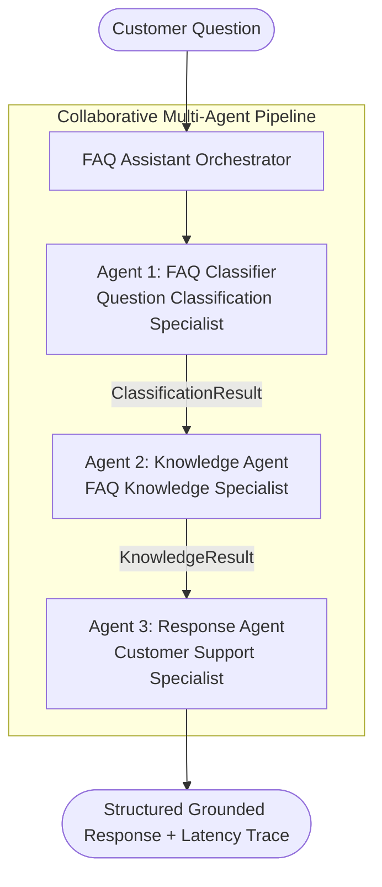
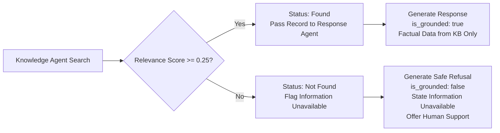

<p align="center">
  
</p>

<p align="center">

[](#-automated-test-suite-45-tests)
[](#-multi-agent-system-architecture)
[](#-installation--setup)
[-success)](#-technology-stack)
[](#-anti-hallucination-engine-requirement-5)

</p>

An enterprise-grade, multi-agent AI customer support assistant built for an online retail shopping platform. The system autonomously processes high-volume customer inquiries regarding **orders**, **payments**, **deliveries**, **returns**, **refunds**, and **general queries**, enforcing strict factual grounding against a predefined knowledge base to prevent hallucinations.

---

## 📋 Table of Contents

1. [Project Overview & Problem Statement](#-project-overview--problem-statement)
2. [Multi-Agent System Architecture](#-multi-agent-system-architecture)
3. [Agent Roles & Responsibilities](#-agent-roles--responsibilities)
4. [Knowledge Base Coverage](#-knowledge-base-coverage)
5. [Anti-Hallucination Engine](#-anti-hallucination-engine-requirement-5)
6. [Technology Stack](#-technology-stack)
7. [Project Directory Layout](#-project-directory-layout)
8. [Installation & Setup](#-installation--setup)
9. [Execution & Run Guide](#-execution--run-guide)
10. [REST API Documentation](#-rest-api-documentation)
11. [Automated Test Suite](#-automated-test-suite-45-tests)
12. [Six Core Assignment Scenarios](#-six-core-assignment-scenarios)

---

## 📌 Project Overview & Problem Statement

An online retail store receives hundreds of questions daily concerning shipments, refunds, returns, order updates, and payment methods. The objective is to replace manual repetitive triage with an autonomous, high-precision **Multi-Agent FAQ Assistant** satisfying five core mandates:

1. **Accept a customer question** across diverse phrasings and lengths.
2. **Identify the category** of the inquiry with intent recognition and confidence scoring.
3. **Search a predefined FAQ knowledge base** using multi-aspect semantic and lexical matching.
4. **Generate an appropriate response** grounded exclusively in verified policy information.
5. **Avoid inventing answers** when verified information is unavailable (strictly eliminate hallucinations).

---

## 🏛️ Multi-Agent System Architecture

The application implements an orchestrated pipeline of three specialized autonomous agents:



---

## 👥 Agent Roles & Responsibilities

### 1. FAQ Classifier (`FAQClassifierAgent`)

- **Role:** Question Classification Specialist
- **Source:** `agents/classifier_agent.py`

Responsibilities:

- Tokenizes, normalizes, and extracts n-grams from customer inquiries.
- Computes weighted lexical scores across six business domains (`orders`, `payments`, `deliveries`, `returns`, `refunds`, `general`).
- Applies contextual disambiguation heuristics, such as distinguishing refund status inquiries from physical return requests.
- Emits a structured `ClassificationResult` containing the top category, confidence (0.0 to 1.0), detected keywords, and execution latency trace.

### 2. Knowledge Agent (`KnowledgeAgent`)

- **Role:** FAQ Knowledge Specialist
- **Source:** `agents/knowledge_agent.py`

Responsibilities:

- Indexes and maintains the 29-entry predefined knowledge base in `knowledge_base/faq_data.json`.
- Uses multi-aspect relevance scoring:
  - Exact query string matching against canonical and alternative questions.
  - Token Jaccard similarity with suffix normalization.
  - Multi-word keyword phrase boosting.
  - Category-scoped search with cross-domain fallback.
- Enforces a minimum relevance threshold (`0.25`). If no FAQ meets the threshold, returns `status = "not_found"`.
- Emits a structured `KnowledgeResult` with the top match, relevance score, related items, and execution trace.

### 3. Response Agent (`ResponseAgent`)

- **Role:** Customer Support Specialist
- **Source:** `agents/response_agent.py`

Responsibilities:

- Synthesizes clear, empathetic, and professional customer service answers.
- Strictly constrains factual claims to the retrieved FAQ information.
- Injects verified policy notices, conditions, and SLA timeframes.
- Suggests related FAQ articles when applicable.
- Enforces Requirement 5: if knowledge is unavailable or out-of-scope, refuses to invent details, explains that verified FAQ information is absent, and provides human representative contact details.
- Emits a structured `ResponseResult` with `is_grounded`, `grounding_source_id`, and a full audit trail.

---

## 📚 Knowledge Base Coverage

The predefined knowledge repository (`knowledge_base/faq_data.json`) contains 29 realistic e-commerce FAQ records across all six domains:

| Category | FAQ ID Range | Topics Covered |
|---|---|---|
| **Orders** | `ORD-001` – `ORD-006` | Order placement, 30-minute cancellation/modification window, live shipment tracking, address changes, VAT invoice downloads, order confirmation delivery |
| **Payments** | `PAY-001` – `PAY-005` | Accepted payment methods (Visa, MasterCard, PayPal, Apple Pay), payment security, declined card troubleshooting, Cash on Delivery limits, installment payments |
| **Deliveries** | `DEL-001` – `DEL-006` | Standard delivery timeline, express/same-day shipping, free shipping threshold, international shipping, missed delivery attempts, delivery delay resolution |
| **Returns** | `RET-001` – `RET-005` | Return policy, non-returnable hygiene items, return label generation, return shipping fees, packaging and condition guidelines |
| **Refunds** | `REF-001` – `REF-005` | Refund processing times, original payment method, store credit option, voucher deductions, missing refund investigations |
| **General** | `GEN-001` – `GEN-003` | Customer care operating hours, phone/email support, account creation, password reset procedures |

---

## 🛡️ Anti-Hallucination Engine (Requirement 5)

A core requirement is to **avoid inventing answers when information is unavailable**. The system implements a deterministic two-phase guardrail:



**Refusal Guarantee:** Under no circumstance will the assistant invent delivery windows to unsupported locations, fabricate return policies for non-existent items, or guess refund terms. If no relevant verified FAQ exists, the system refuses to guess and recommends human support.

---

## 💻 Technology Stack

- **Runtime:** Python 3.10+ (Standard Library: `http.server`, `urllib`, `json`, `dataclasses`, `unittest`, `re`).
- **Dependencies:** Zero external Python package dependencies required.
- **Frontend:** Responsive enterprise dashboard built with semantic HTML5, modern CSS3, and vanilla JavaScript.
- **Testing:** Python `unittest` suite with 45 unit, integration, and DOM tests.
- **LLM Augmentation:** `agents/llm_client.py` performs optional provider connectivity checks only; it does not generate customer answers.

---

## 📂 Project Directory Layout

```text
ShopSmart-AI/
├── knowledge_base/
│   └── faq_data.json          # Predefined 29-entry FAQ Knowledge Base
├── agents/
│   ├── __init__.py            # Module exports
│   ├── base_agent.py          # Abstract BaseAgent & AgentTrace dataclasses
│   ├── classifier_agent.py    # Agent 1: FAQ Classifier
│   ├── knowledge_agent.py     # Agent 2: Knowledge Agent
│   ├── response_agent.py      # Agent 3: Response Agent
│   └── llm_client.py          # Optional provider connectivity probe
├── assistant.py               # Main multi-agent orchestrator
├── main.py                    # Multi-mode CLI tool
├── server.py                  # HTTP API server & web dashboard host
├── web/
│   └── index.html             # Enterprise visual multi-agent dashboard
├── tests/
│   ├── __init__.py
│   ├── test_faq_assistant.py  # 42 unit & integration tests
│   └── test_frontend_dom.py   # 3 DOM & JavaScript syntax tests
├── .env.example               # Environment variables configuration template
├── .gitignore                 # Standard clean ignore file
└── README.md                  # Project documentation
```

---

## ⚡ Installation & Setup

### 1. Clone the Repository

```bash
git clone https://github.com/haniaeman2026-pixel/ShopSmart-AI.git
```

### 2. Navigate to the Project

```bash
cd ShopSmart-AI
```

### 3. Verify Python 3.10 or Newer

```bash
py --version
```

### 4. Optional Environment Configuration

Copy `.env.example` to `.env` only if you want to configure an optional provider connectivity check.

```bash
cp .env.example .env
```

**Note:** The current implementation runs locally without API keys. It uses deterministic classification, FAQ retrieval, and grounded response templates; no external LLM inference is performed.

---

## 🚀 Execution & Run Guide

### 1. Run Predefined Demo Suite

Executes the six primary assignment scenarios plus additional edge cases:

```bash
py main.py
```

### 2. Single Question via CLI

```bash
py main.py --question "How long does standard delivery take?"
```

### 3. Machine-Readable JSON Output

```bash
py main.py --question "When will I receive my refund?" --json
```

### 4. Interactive Terminal Session

```bash
py main.py --interactive
```

### 5. Launch the Web Dashboard

```bash
py server.py 8010
```

Open your browser at:

```text
http://localhost:8010/
```

---

## 🌐 REST API Documentation

The server exposes dedicated REST endpoints for the complete pipeline as well as individual agent inspection:

| Method | Endpoint | Description | Request Body |
|---|---|---|---|
| `GET` | `/api/health` | Service health, active agents, and LLM provider status | None |
| `GET` | `/api/kb` | Returns full knowledge base entries and metadata | None |
| `GET` | `/api/history` | Chronological session inquiry history | None |
| `POST` | `/api/ask` | End-to-end multi-agent pipeline execution | `{"question": "..."}` |
| `POST` | `/api/classify` | Invokes Agent 1 (FAQ Classifier) | `{"question": "..."}` |
| `POST` | `/api/retrieve` | Invokes Agent 2 (Knowledge Agent) | `{"query": "...", "category": "..."}` |
| `POST` | `/api/respond` | Invokes Agent 3 (Response Agent) | `{"question": "...", "category": "..."}` |

Example request:

```json
{
  "question": "How can I track my order?"
}
```

---

## 🧪 Automated Test Suite (45 Tests)

Run all 45 unit, integration, scenario, and DOM tests:

```bash
py -m unittest discover -s tests -v
```

### Test Coverage Summary

- **`TestAssignmentSixScenarios` (6 tests):** Validates Scenarios 1 through 6.
- **`TestFAQClassifierAgent` (14 tests):** Validates classification across orders, payments, deliveries, delays, returns, refunds, general queries, empty strings, and out-of-scope inputs.
- **`TestKnowledgeAgent` (6 tests):** Validates knowledge base indexing, exact matching, retrieval, empty queries, and threshold gating.
- **`TestResponseAgent` (2 tests):** Validates grounded answer synthesis and anti-hallucination refusal formatting.
- **`TestEndToEndPipeline` (4 tests):** Validates trace propagation, latency, serialization, and LLM status structure.
- **`TestHTTPAPIEndpoints` (9 tests):** Validates API routes, bad-request handling, and 404 routing.
- **`TestFrontendIntegrity` (3 tests):** Validates HTML structure, required DOM IDs, and JavaScript syntax verification.

**Verified Result:** All 45 tests passed.

---

## 🎯 Six Core Assignment Scenarios

The six scenarios from the assignment are verified by the automated tests:

### Scenario 1: Order Tracking

- **Input:** "How can I track my order?"
- **Agent 1:** Classifies the inquiry into `orders` (confidence: `0.98`).
- **Agent 2:** Retrieves FAQ `ORD-003`.
- **Agent 3:** Formulates a grounded response with shipment confirmation details, carrier tracking instructions, and update conditions.
- **Status:** **PASS**

### Scenario 2: Payment Methods

- **Input:** "Which payment methods do you accept?"
- **Agent 1:** Classifies the inquiry into `payments` (confidence: `0.98`).
- **Agent 2:** Retrieves FAQ `PAY-001`.
- **Agent 3:** Lists payment methods recorded in the FAQ.
- **Status:** **PASS**

### Scenario 3: Delivery Delay

- **Input:** "My delivery is delayed. What should I do?"
- **Agent 1:** Classifies the inquiry into `deliveries`.
- **Agent 2:** Retrieves FAQ `DEL-006`.
- **Agent 3:** Explains tracking status checks and documented support escalation guidance.
- **Status:** **PASS**

### Scenario 4: Return Procedures

- **Input:** "How can I return a product?"
- **Agent 1:** Classifies the inquiry into `returns`.
- **Agent 2:** Retrieves the relevant return FAQ.
- **Agent 3:** Provides the documented return process.
- **Status:** **PASS**

### Scenario 5: Refund Timeline

- **Input:** "When will I receive my refund?"
- **Agent 1:** Classifies the inquiry into `refunds`.
- **Agent 2:** Retrieves FAQ `REF-001`.
- **Agent 3:** Explains the refund processing timeline documented in the FAQ.
- **Status:** **PASS**

### Scenario 6: Missing Policy — Anti-Hallucination Guardrail

- **Input:** "Can you deliver my order via spaceship to Mars?"
- **Agent 1:** Classifies the inquiry into `deliveries`.
- **Agent 2:** Finds no sufficiently relevant FAQ. The relevance score is below the `0.25` threshold.
- **Agent 3:** Refuses to guess, explains that the policy is unavailable, and directs the customer to the configured support channel.
- **Status:** **PASS**

---

## Important Implementation Note

This submission currently uses a deterministic three-agent pipeline: rule-based intent classification, FAQ retrieval, and template-based grounded response generation. The optional `llm_client.py` performs a provider connectivity check only; it is **not** connected to answer generation. Do not describe the current build as using a live generative LLM unless that integration is implemented and tested separately.

The web server serves `web/index.html` at `/`. If Chrome shows a JSON 404 page, stop any older server process using port 8010 (`Ctrl+C` in its terminal), then start this project's server from the project root:

```bash
py server.py 8010
```

Confirm the terminal prints the ShopSmart URL before opening `http://localhost:8010/`.

---

<p align="center">
  **Developed by Hania Eman**
</p>

<p align="center">
  Built with Python and a collaborative multi-agent architecture.
</p>
